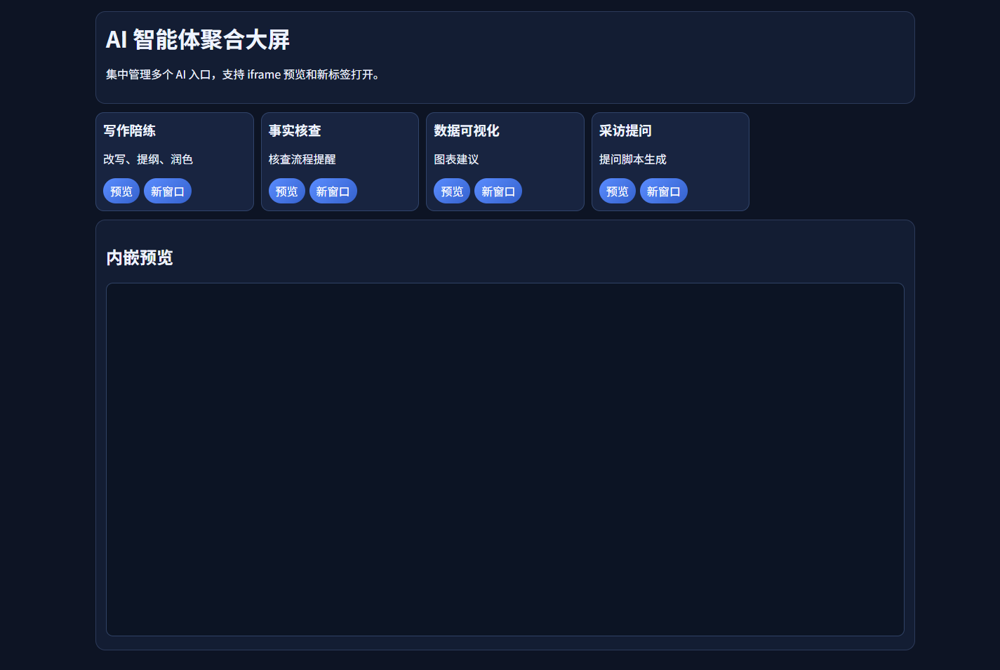

# P41 AI 智能体聚合大屏

统一管理 AI 入口卡片，支持搜索、分类筛选、iframe 预览与新标签打开。

## 这次修复与增强

- 补齐最初设计要求：搜索 + 分类筛选 + 本地 JSON 配置。
- 加入 iframe 预览失败降级提示（部分站点禁嵌入时可一键新开）。
- 入口卡片升级：分类/标签可见，便于快速定位工具。
- 配置面板支持热更新与恢复默认，便于团队维护入口清单。


## 隐私说明

- 所有数据处理均在浏览器本地完成，不上传任何数据至服务器。
- 如涉及 API 调用，密钥仅保留在当前页面内存中，不做持久化存储。
- 详见页面底部隐私提示。

## 已知限制

- 仅支持现代 Chromium 内核浏览器 (Chrome 110+, Edge 110+)。
- 项目链接失效。
- 本工具为前端纯静态实现，不含后端服务。
## 产品化优化（PM）

### 优化目标
- 把单点能力打磨成可复用产品模块，提升留存。

### 目标用户
- 一线用户：希望在 3 分钟内完成核心任务的内容/数据/核查从业者。
- 管理者：关注输出质量稳定性、效率提升和可复用流程。

### 核心使用场景
- 将能力打包为可交付页面
- 支持轻量私有部署和复用
- 作为产品矩阵统一入口

### 北极星指标（上线后 2 周）
- 首次任务完成率 >= 70%
- 核心任务完成时长 P50 <= 3 分钟
- 7 日回访率 >= 20%

### 下一步迭代（按优先级）
1. 统一导航与信息架构
2. 补齐项目级指标面板
3. 增强组合使用场景（串联工作流）

## 数据化追踪（PM）

### 已接入埋点事件
- `page_view`：页面访问
- `first_interaction`：首次交互时延
- `cta_click`：核心按钮点击
- `task_start` / `task_complete` / `task_error`：核心任务生命周期
- `status_success_signal` / `status_error_signal`：状态文本成功/失败信号
- `page_hidden` / `page_unload`：页面停留与离开

### 看板字段（统一）
- `project_id`（例如：P41-agent-portal）
- `project_cluster`
- `session_id`
- `event_name`
- `event_time`
- `page_path`
- `control_id`
- `task_name`（当前项目默认：productization_core_task）
- `task_duration_ms`
- `elapsed_ms`
- `status_text`

### 本地查看与导出
在浏览器控制台执行：

```js
window.pmMetrics.getSummary()
window.pmMetrics.exportEvents()
```

### 上线后两周目标
- 首次交互时延 P50 <= 10 秒
- 核心任务完成率 >= 70%
- 核心任务完成时长 P50 <= 180 秒

<!-- PLAYWRIGHT_REVIEW:START -->
## 页面效果截图（Playwright）

> Captured: 2026-03-02T09:19:19.915Z | Mode: headed (non-headless)



## 可改进点（自动巡检）
- 增强首屏任务引导与主按钮文案，提升首次任务启动率。
- 补充空状态和错误状态指引，减少用户中断。

- 巡检信号：console_error=0，request_failed=0，load_ms=2903
- 页面标题：P41 AI 智能体聚合大屏

<!-- PLAYWRIGHT_REVIEW:END -->

